## Цель работы
Исследование свойств универсальных алгоритмов синтаксического анализа контекстно-свободных языков.
## Ход работы 
1. Ознакомиться с теоретическими сведениями о нормальной форме Хомского и универсальных алгоритмах синтаксического анализа.
2. Получить у преподавателя собственный вариант задания с описанием контекстно-свободного языка, распознаваемого алгоритмом Кока-Янгера-Касами.
3. Используя изученные механизмы, определите в системе JFLAP согласно постановке задачи соответствующую КСГ. Определенный таким образом язык должен анализироваться алгоритмом Кока-Янгера-Касами. В случае невозможности создания КСГ это должно доказываться формально.
4. Написать отчет и представить его на проверку вместе с полученной JFLAP-моделью.
## Вариант 7
Язык оператора присваивания, в правой части которого задано
выражение. Элементами выражений являются даты двух любых форматов,
имена переменных из одного символа (от a до d), знаки операций и скобки для
изменения порядка вычисления подвыражений. Операции (в сторону
уменьшения приоритета): унарная, бинарные, присваивание.  
# Часть 1
## Полученное регулярное выражение
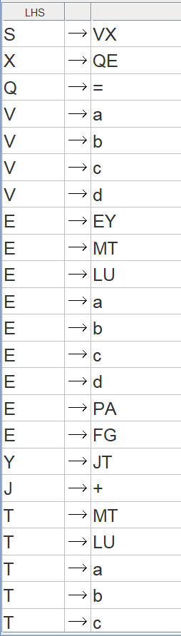
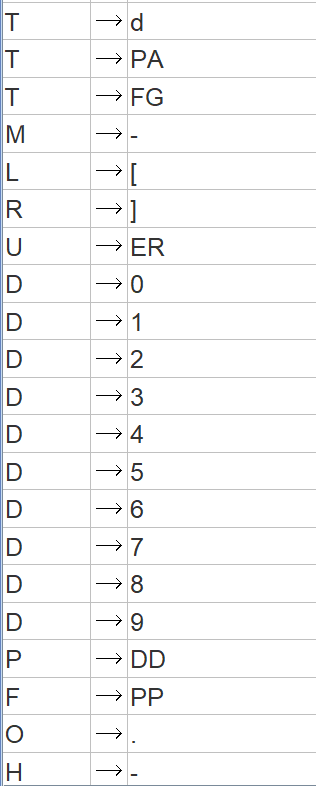
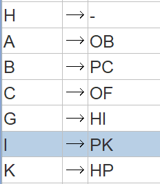
## Пошаговое выполнение цепочек
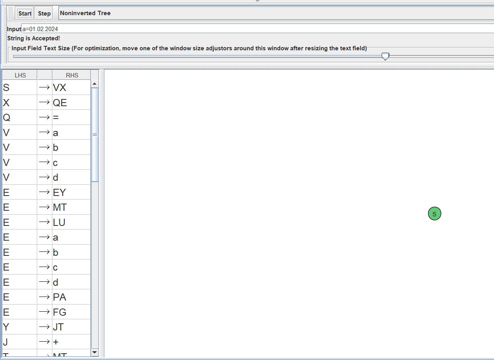
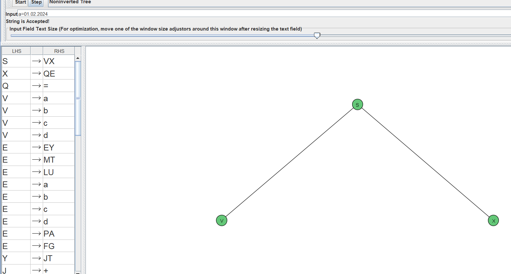
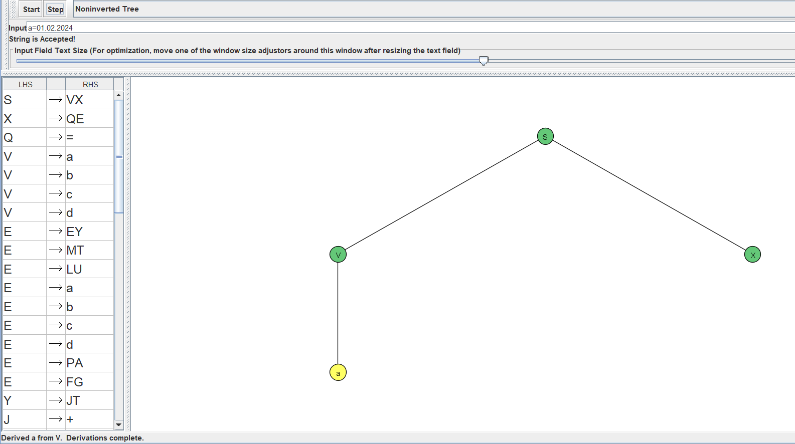
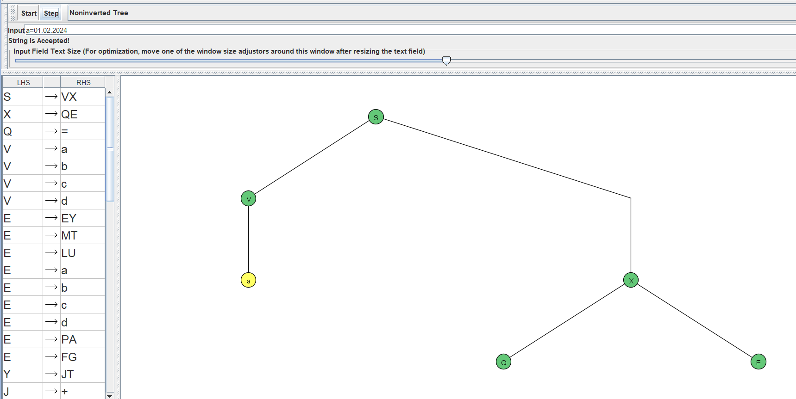
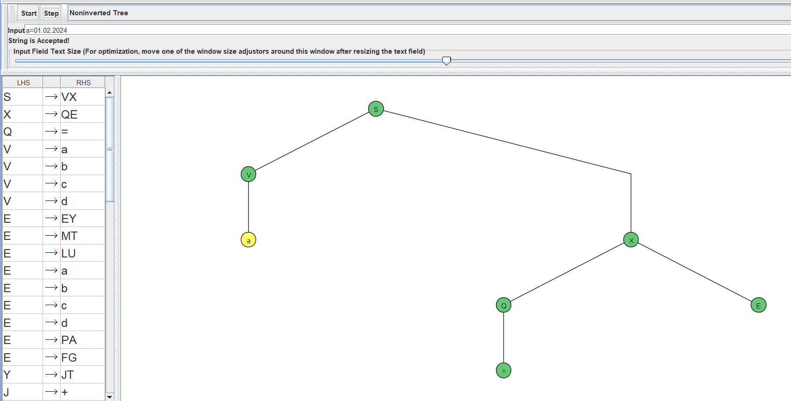
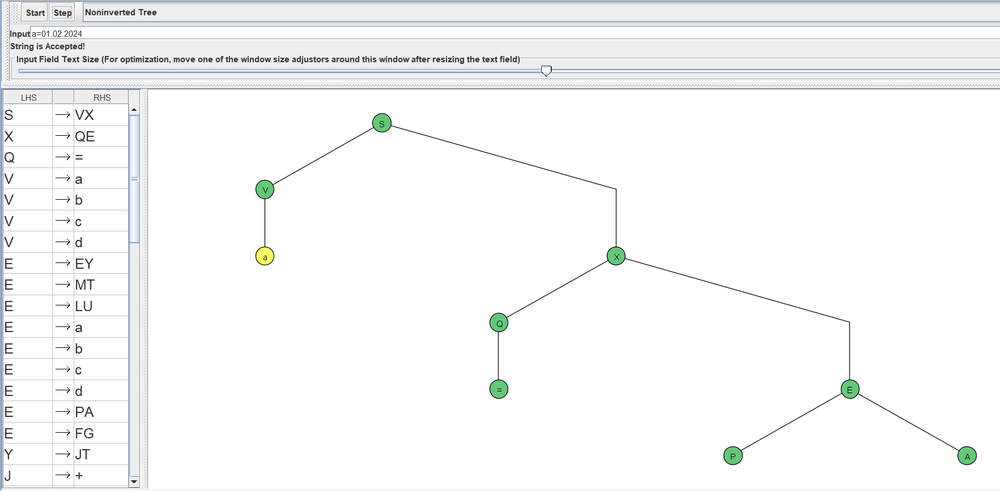
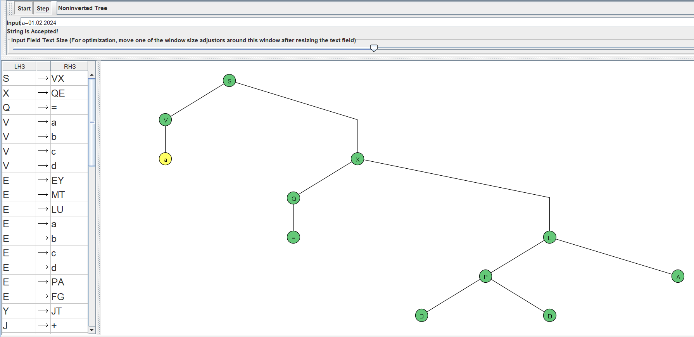
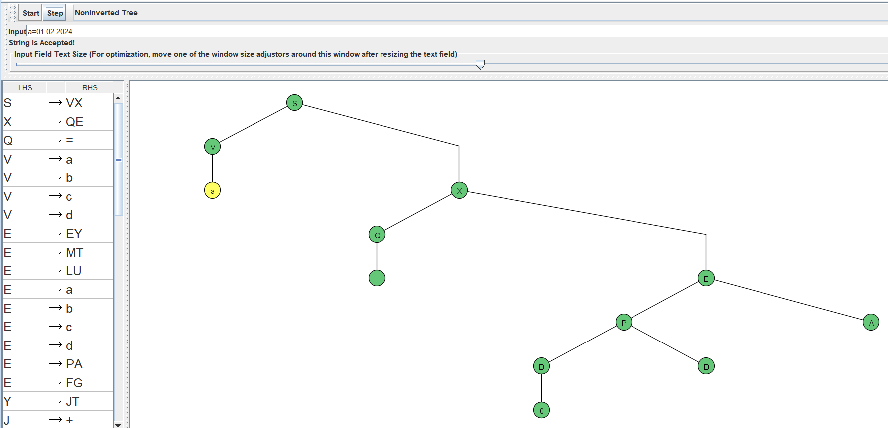
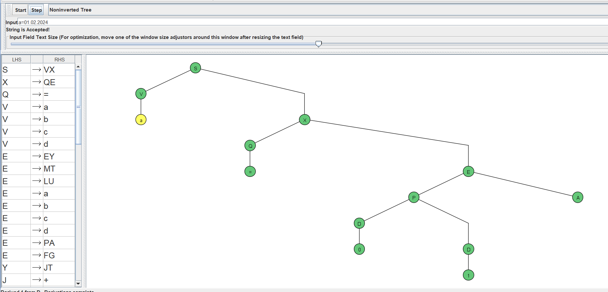
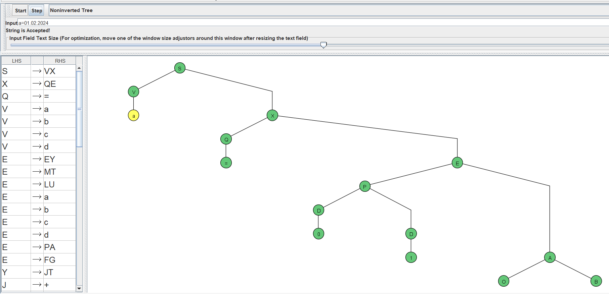
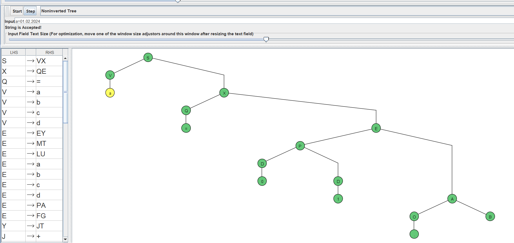
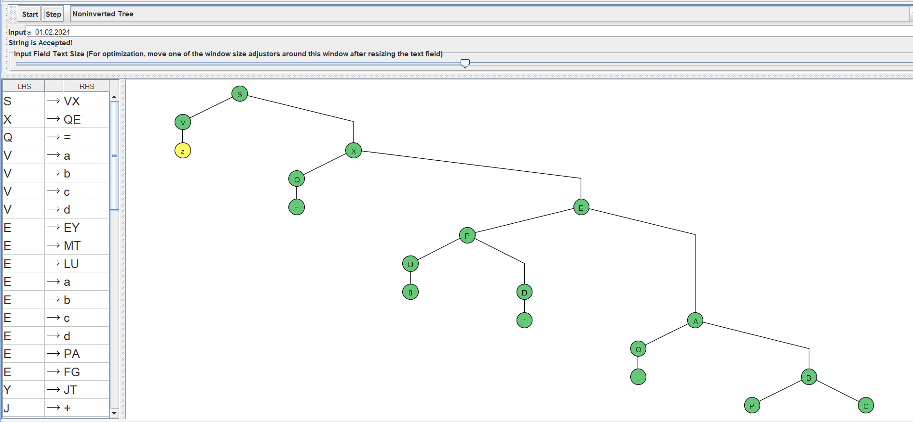
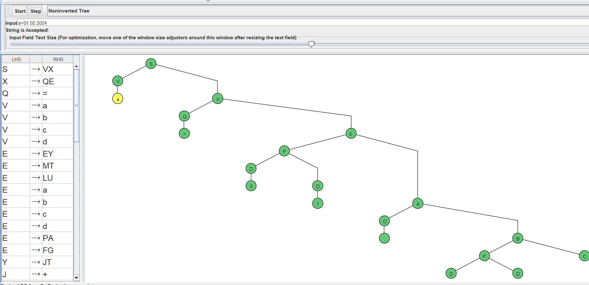
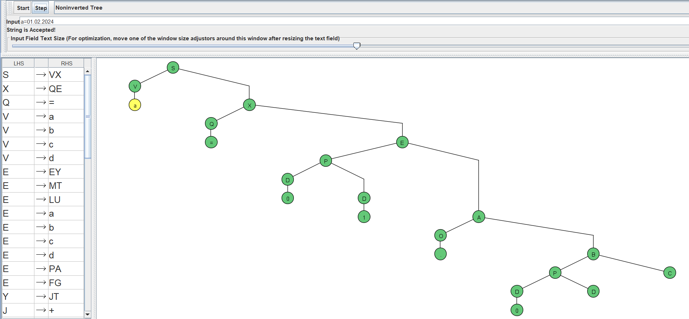
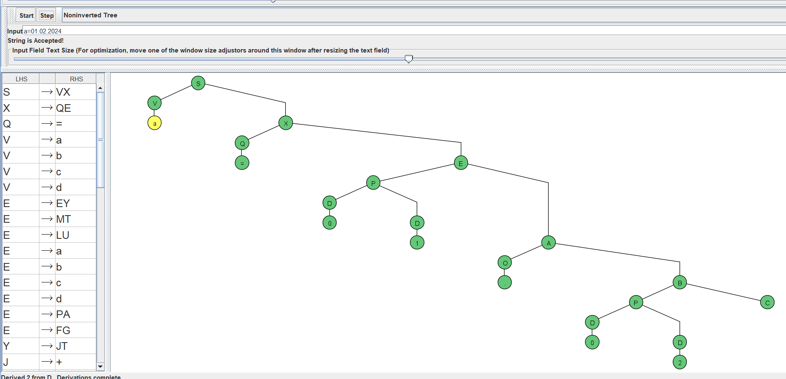
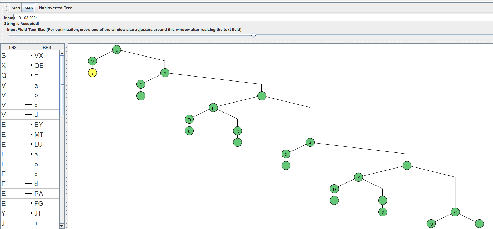
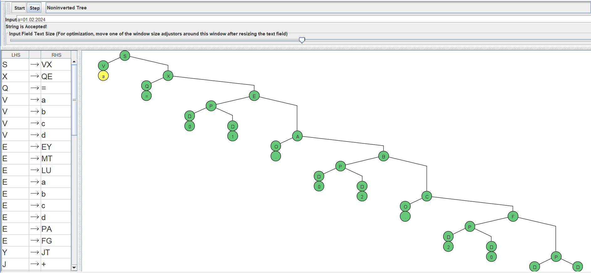
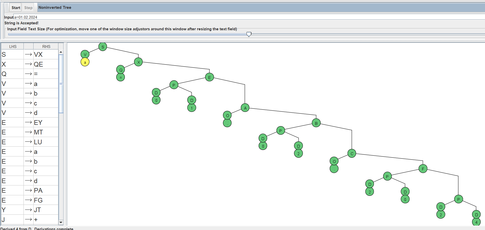